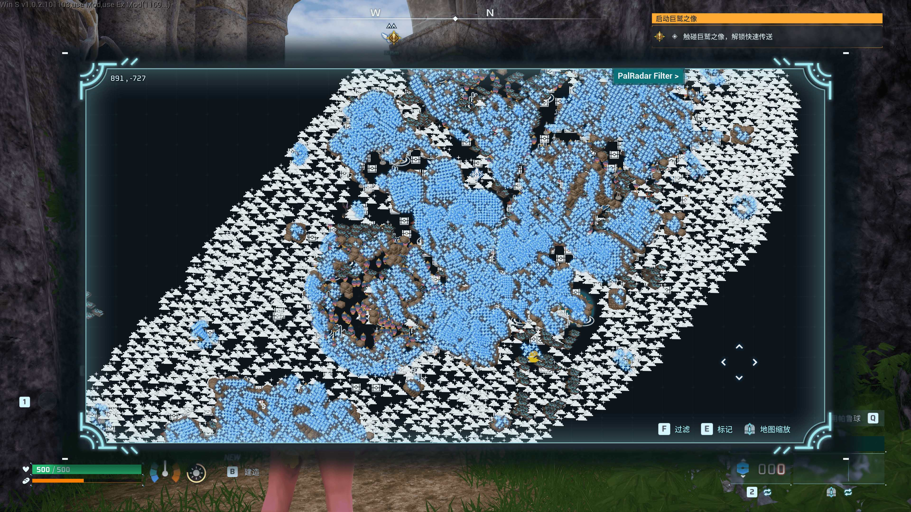

# 探索者的遗产 (Explorer's Legacy)

> 基于 UE4SS / Lua 构建的《幻兽帕鲁》大地图全资源动态过滤与渲染系统。

---

## 🌟 核心特性

- **多档位动态渲染**：支持在 **低档 / 标准档 / 高档 / 全量** 模式自由切换，兼顾低配帧数与全图检索。
- **全维度点位覆盖**：
  - **核心据点**：据点、区域头目、悬赏头目、油田要塞、补给点
  - **收集与探索**：技能果树、藏宝图、笔记、帕鲁蛋、钓鱼/打捞点、帕鲁雕像
  - **自然资源**：煤矿、硫磺、石英、天坠矿、世界树矿
  - **生态 NPC**：地下城首领、商人、各类普通帕鲁精确点位

---

## 🧩 v1.0.2 更新

- 修复地图关闭后再次打开、退回主菜单后再次进入时筛选面板可能失效的问题。
- 恢复并稳定首领头像、普通帕鲁头像、宝箱、技能果树、帕鲁蛋、钓鱼/打捞点等图标显示。
- 优化图标加载、取消加载和清理逻辑，降低残留图标与重复计数风险。
- 保留本次游戏内的地图筛选状态；退回标题页或重启游戏后恢复默认状态。

---

## 🛠️ 安装方法

### 方式 A：Steam 创意工坊（推荐）
直接在 Steam 创意工坊搜索并订阅 **“探索者的遗产”** 即可自动完成安装与更新。

### 方式 B：GitHub 手动安装
1. 确保已安装 **UE4SS**。
2. 下载本仓库最新 [Releases](../../releases) zip 包。
3. 将解压后的 `PalRadarPrecursor` 文件夹放入游戏目录：
   `Palworld/Pal/Binaries/Win64/Mods/`
4. 确保在 UE4SS 的 `mods.txt` 中启用该 MOD：
   `PalRadarPrecursor : 1`

---

## 📜 许可证

本项目基于 [MIT License](LICENSE) 开源。
